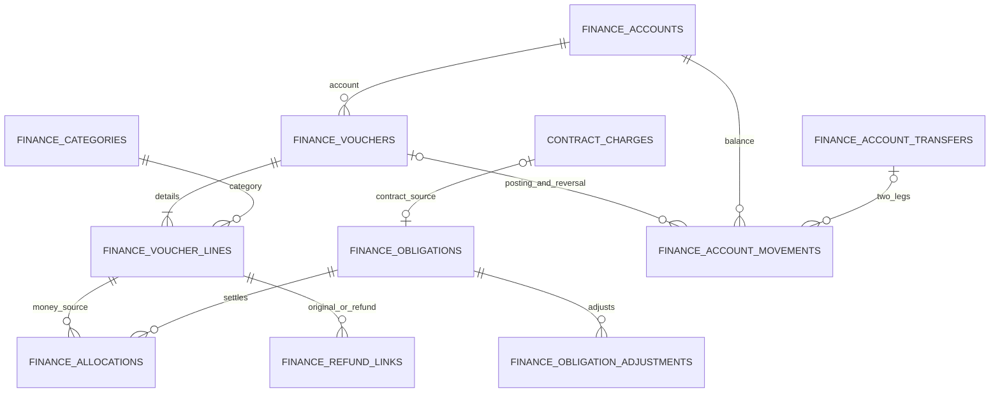

# Thu chi & Công nợ — Đặc tả nghiệp vụ và mô hình dữ liệu

- Ngày: 2026-09-13.
- Trạng thái: đặc tả thiết kế ban đầu theo phạm vi đã thống nhất; chưa triển khai code, migration hoặc thay đổi dữ liệu.
- UI đã chốt: các trang mới nằm trong nhóm menu Quản trị; khoản mục nằm trong nhóm “Khoản mục thu chi” tại `/tags`; `/reports` là trang báo cáo chung, mở rộng theo nhiều nghiệp vụ.
- Mục tiêu: quản lý thu chi và công nợ nội bộ của tổ chức cung cấp dịch vụ; có nền tảng mở rộng nghiệp vụ mà không phải gộp/xóa các bảng lõi.
- Tài liệu này là thiết kế đích cho module tài chính. Code hiện tại vẫn là nguồn xác nhận hành vi đã triển khai.
- Khi triển khai, tài liệu này thay thế phần mô hình thanh toán/công nợ trong [thiết kế hợp đồng cũ](../../superpowers/specs/2026-08-15-contract-and-receivables-module-design.md). Không thay thế quy tắc phiên bản, khoản phí, chu kỳ và sinh kỳ hợp đồng ngoài các điểm chuyển đổi được ghi rõ tại mục 13.

## 1. Quyết định thiết kế

1. Một phiếu có đầu phiếu và nhiều dòng chi tiết. Khoản mục thu chi nằm trên từng dòng, không nằm chung bắt buộc ở đầu phiếu.
2. Một phiếu thể hiện một lần thu/chi, một tổ chức, một đối tượng chính, một quỹ/tài khoản và một loại tiền. Không gom các lần chuyển tiền cho nhiều người nhận thành một phiếu.
3. Công nợ, chứng từ tiền và quan hệ thanh toán là ba thực thể riêng. Công nợ có thể tồn tại trước tiền; tiền có thể không gắn công nợ.
4. Chi tiết phiếu trả lời “tiền về việc gì”; phân bổ trả lời “phần tiền này thanh toán khoản nợ nào”. UI cho chọn công nợ ngay trên dòng; backend tạo phân bổ cùng transaction.
5. Dùng một bảng phân bổ cho cả thanh toán ngay và sử dụng ứng trước sau này. Không lưu `obligation_id` như một nguồn thanh toán thứ hai trực tiếp trên dòng phiếu.
6. Không tạo `finance_parties` ở giai đoạn đầu. Phiếu và công nợ dùng khóa ngoại cụ thể tới khách hàng/nhân viên hiện có; đối tượng vãng lai chỉ cần tên khi thu/chi trực tiếp.
7. Khoản mục là bảng cấu hình theo tổ chức, có dữ liệu mặc định và quyền quản trị. Loại phiếu, chiều công nợ, cách xử lý dòng là tập giá trị nghiệp vụ do hệ thống kiểm soát.
8. Ghi nhận phiếu làm thay đổi tiền; phân bổ không làm thay đổi tiền. Nhập/điều chỉnh công nợ không sinh phiếu thu chi giả.
9. Không sửa/xóa dữ liệu tài chính đã ghi nhận. Dùng điều chỉnh, đảo hoặc hoàn tiền có liên kết và thời điểm hiệu lực rõ ràng.
10. Mở rộng bằng bảng nghiệp vụ và khóa ngoại mới, giữ định danh và ý nghĩa của các bảng lõi. Không hứa schema không bao giờ thay đổi; mục tiêu là migration bổ sung, không tái cấu trúc nền tảng cho các nhu cầu đã biết.

### 1.1. Ví dụ xuyên suốt

Khách hàng A chuyển 15 triệu vào tài khoản ngân hàng công ty:

| Dòng phiếu | Khoản mục | Cách xử lý | Số tiền | Công nợ thanh toán |
| --- | --- | --- | ---: | --- |
| 1 | Thu phí hợp đồng | `settlement` | 8.000.000 | Kỳ tháng 9 của HĐ001 |
| 2 | Thu công nợ cũ | `settlement` | 5.000.000 | Công nợ đầu kỳ của A |
| 3 | Khách hàng ứng trước | `advance` | 2.000.000 | Chưa có |

- Đầu phiếu: tổng 15 triệu; tổng ba dòng cũng là 15 triệu.
- Hai phân bổ ban đầu: 8 triệu và 5 triệu, tham chiếu dòng 1 và 2.
- Một biến động ngân hàng: tiền vào 15 triệu.
- Dòng 3 còn 2 triệu ứng trước. Khi dùng trả kỳ sau, thêm phân bổ từ dòng 3; không tạo phiếu thu hoặc biến động tiền mới.
- Một dòng có thể thanh toán nhiều khoản nợ cùng đối tượng. UI mặc định hiển thị từng khoản nợ được chọn để dễ kiểm tra.

## 2. Phạm vi

### 2.1. Bắt buộc trong bản nghiệp vụ cơ bản

| Nhóm | Phạm vi |
| --- | --- |
| Phiếu | Thu/chi, nhiều dòng khoản mục, nháp/ghi nhận/đảo, in phiếu, đính kèm chứng từ |
| Hợp đồng | Thu khoản phải thu; chi khoản phải trả; trả một phần/nhiều lần/nhiều kỳ/nhiều hợp đồng của cùng khách hàng |
| Công nợ khác | Công nợ đầu kỳ và thủ công của khách hàng, cả phải thu/phải trả; ngày ghi nhận, hạn thanh toán, tham chiếu nguồn |
| Thu chi trực tiếp | Không yêu cầu hợp đồng hoặc công nợ; có nội dung, khoản mục, đối tượng và tài khoản |
| Ứng trước | Nhận/chi ứng trước khách hàng; giới hạn theo khách hàng hoặc một hợp đồng; sử dụng về sau; hoàn phần chưa sử dụng |
| Điều chỉnh | Tăng/giảm công nợ có lý do; xử lý hủy dịch vụ/giảm phí mà không giả lập dòng tiền |
| Hoàn tiền | Hoàn tiền trực tiếp hoặc tiền còn khả dụng trên dòng thanh toán/ứng trước; truy được tới dòng tiền gốc |
| Quỹ | Số dư đầu kỳ, biến động, chuyển quỹ cùng loại tiền, đối chiếu số dư với thực tế/sao kê bằng báo cáo và kiểm tra thủ công |
| Kiểm soát | Phân quyền, tenant/scope, chống ghi trùng, kiểm soát đồng thời, lịch sử, khóa đến ngày đã chốt |
| Báo cáo | Sổ thu chi; số dư tài khoản; phải thu/phải trả, quá hạn; tiền ứng trước/chờ xử lý; lịch sử theo khách hàng/hợp đồng |

### 2.2. Điểm mở rộng, chưa triển khai nghiệp vụ

- Tính và duyệt hoa hồng; tự sinh khoản phải trả nhân viên. Có sẵn khóa ngoại `employee_id`, nhưng chưa cung cấp luồng hoa hồng/tạm ứng nhân viên trong bản đầu.
- Hồ sơ nhà cung cấp/đối tác khác và công nợ của họ. Bản đầu chỉ hỗ trợ đối tượng vãng lai cho thu chi trực tiếp, không quản lý nợ dựa trên tên tự nhập.
- Tạm ứng và quyết toán nhân viên, chi hộ/thu hộ, đặt cọc có điều kiện. Không đồng nhất với ứng trước thanh toán dịch vụ.
- Phê duyệt nhiều cấp, đề nghị thanh toán, chi tiền hàng loạt.
- Nhập sao kê/đối soát tự động, ngân hàng trực tuyến, chuyển quỹ đang đi đường.
- Bù trừ phải thu/phải trả không qua tiền, nhiều tiền tệ trên một giao dịch, tỷ giá.
- Hóa đơn điện tử, thuế, sổ cái và định khoản, phân bổ doanh thu/chi phí, báo cáo tài chính.

Thu/chi phản ánh dòng tiền. Không đặt tên tổng thu trừ tổng chi là lợi nhuận; không mặc định thu ứng trước là doanh thu hoặc chi ứng trước là chi phí.

## 3. Thuật ngữ và quan hệ

| Khái niệm | Ý nghĩa |
| --- | --- |
| Phiếu | Chứng từ thu/chi tiền; trạng thái nháp chưa tác động số dư |
| Chi tiết phiếu | Một phần tiền trên phiếu, có nội dung, khoản mục và cách xử lý riêng |
| Khoản mục | Danh mục phân loại như thu phí dịch vụ, chi thuê văn phòng, chi điện |
| Công nợ | Nghĩa vụ phải thu/phải trả của tổ chức đối với một đối tượng |
| Phân bổ/đối trừ thanh toán | Liên kết một phần tiền trên chi tiết phiếu với một khoản công nợ; không phải bù trừ phải thu với phải trả |
| Ứng trước | Tiền đã thực nhận/chi nhưng chưa hoặc mới sử dụng một phần để thanh toán nghĩa vụ |
| Hoàn tiền | Một giao dịch tiền mới ngược chiều, liên kết tiền gốc |
| Đảo chứng từ | Sửa sai ghi nhận, có sự kiện ngược hiệu lực; không khẳng định có chuyển tiền thực tế mới |

Phiếu nháp có thể chưa có dòng; phiếu đã ghi nhận phải có ít nhất một dòng. Quan hệ công nợ hợp đồng là 1–1 cho khoản đã tích hợp; công nợ ngoài hợp đồng không có `contract_charge_id`.

## 4. Quy ước dữ liệu chung

- Khóa chính `id uuid`; mọi bảng thuộc tổ chức có `tenant_id uuid not null`. Khóa ngoại nội bộ tài chính nên kiểm tra cặp `(tenant_id, id)`; các bảng cũ chưa có composite key phải được kiểm tra tenant ở backend cùng transaction, không chỉ ở UI.
- Tiền dùng `numeric(18,2)`, không dùng float để cộng/trừ ở backend. API nhận/trả chuỗi thập phân; preview frontend không là nguồn xác nhận số tiền.
- Số tiền nghiệp vụ luôn dương; chiều tiền/chiều điều chỉnh lưu riêng. Số dư đầu kỳ có thể âm với tài khoản ngân hàng sau xác nhận dữ liệu; quỹ tiền mặt đầu kỳ không âm.
- Một tài khoản một `currency_code`; bản đầu vận hành VND. Giữ mã tiền tệ và chặn mọi phân bổ/hoàn/chuyển quỹ chéo tiền tệ. Không cộng nhiều tiền tệ trong cùng một tổng.
- Số phiếu/mã công nợ duy nhất trong tenant theo loại và kỳ đánh số; cấp ở backend khi ghi nhận, không tái sử dụng số đã hủy/đảo.
- `created_at/created_by` là thời điểm/người ghi dữ liệu; `effective_date` hoặc ngày giao dịch là ngày hiệu lực nghiệp vụ. Lưu cả hai để phân biệt nhập muộn với sự kiện phát sinh muộn.
- Dùng timezone cấu hình của tổ chức cho ngày sổ; timestamp lưu UTC. Không lấy timezone trình duyệt làm ngày khóa sổ.
- Mọi bảng nghiệp vụ có metadata tạo; bảng nháp/danh mục có `updated_at` và revision cho optimistic concurrency. Metadata ghi nhận/đảo được mô tả bên dưới.
- Không cascade delete lịch sử tài chính khi xóa khách hàng, nhân viên, hợp đồng, tài khoản hay tenant. Dùng hạn chế xóa/lưu trữ và quy trình riêng nếu cần xóa toàn tổ chức.
- Tên đối tượng và khoản mục trên chứng từ được snapshot lúc ghi nhận để đổi tên danh mục không đổi bản in lịch sử. Snapshot là dữ liệu chứng từ, không phải hồ sơ đối tác thứ hai.
- Không dùng JSON để lưu danh sách dòng phiếu/phân bổ thay cho bảng quan hệ. JSON chỉ phù hợp metadata import, kết quả thao tác hoặc audit đã lọc dữ liệu nhạy cảm.

## 5. Bảy bảng lõi

### 5.1. `finance_accounts` — Quỹ và tài khoản

| Cột | Kiểu / quy tắc | Ý nghĩa |
| --- | --- | --- |
| `code`, `name` | text, bắt buộc | Mã duy nhất trong tenant; tên |
| `account_type` | `cash`, `bank` | Loại tài khoản |
| `currency_code` | text, bắt buộc | Loại tiền |
| `bank_name`, `bank_account_number`, `bank_account_holder` | text, nullable | Thông tin ngân hàng |
| `opening_date` | date, bắt buộc khi kích hoạt sổ | Số dư đầu ngày này |
| `opening_balance` | numeric | Số dư được đối soát tại mốc mở sổ |
| `opening_confirmed_at`, `opening_confirmed_by` | timestamp/uuid, nullable | Xác nhận số dư đầu kỳ |
| `is_active` | boolean | Cho phép giao dịch mới |

Sau xác nhận mở sổ và có biến động, không sửa đầu kỳ trực tiếp. Sửa sai qua quy trình quản trị được audit, mở lại kỳ và đối soát toàn khoảng bị ảnh hưởng. Chặn ghi giao dịch hiệu lực trước `opening_date` của sổ đang vận hành.

### 5.2. `finance_categories` — Khoản mục

| Cột | Kiểu / quy tắc | Ý nghĩa |
| --- | --- | --- |
| `code`, `name` | text | Mã duy nhất trong tenant, tên |
| `parent_id` | FK cùng tenant, nullable | Nhóm cha; không được tạo vòng lặp |
| `direction` | `receipt`, `payment`, `both` | Chiều phiếu được chọn |
| `is_active`, `sort_order` | boolean/integer | Trạng thái và thứ tự |

Có bộ mặc định như thu phí hợp đồng, thu công nợ cũ, thu khác, chi vận hành, ứng trước và hoàn tiền. Người có quyền quản trị có thể thêm/đổi tên/ngừng sử dụng; không xóa khoản mục đã được tham chiếu. Không đổi mã/chiều làm sai chứng từ cũ. Khoản mục không tự quyết định việc trừ nợ hoặc ghi nhận doanh thu.

UI quản lý bảng này nằm trong nhóm hệ thống “Khoản mục thu chi” của trang Danh mục `/tags` (mục 9.7). Nhóm điều hướng danh mục không thay thế bảng `finance_categories` bằng tags gắn nhãn thông thường.

### 5.3. `finance_obligations` — Công nợ

| Cột | Kiểu / quy tắc | Ý nghĩa |
| --- | --- | --- |
| `code`, `description` | text | Mã và nội dung |
| `party_type` | `customer`, `employee` | Đối tượng có định danh; bản đầu mở nghiệp vụ khách hàng |
| `customer_id`, `employee_id` | FK cụ thể, nullable | Đúng một FK theo `party_type` |
| `party_name_snapshot` | text | Tên khi ghi nhận |
| `direction` | `receivable`, `payable` | Góc nhìn tổ chức |
| `source_type` | `contract`, `opening_balance`, `manual`, `commission` | Nguồn; commission dành cho mở rộng |
| `contract_charge_id` | FK `contract_charges`, nullable, unique | Một khoản nợ cho mỗi charge thật |
| `contract_id` | FK, nullable | Ngữ cảnh hợp đồng; bắt buộc và khớp charge với nguồn contract |
| `category_id` | FK, nullable | Gợi ý khoản mục lúc thanh toán |
| `document_date`, `due_date` | date; due nullable | Ngày ghi nhận và hạn |
| `original_amount`, `currency_code` | numeric/text | Giá trị gốc bất biến sau ghi nhận |
| `external_reference`, `import_batch_id` | text/uuid, nullable | Nguồn phần mềm cũ/import |
| `status` | `draft`, `posted`, `voided` | Trạng thái chứng từ |
| `posted_at`, `posted_by` | timestamp/uuid | Thông tin ghi nhận |
| `voided_at`, `voided_by`, `void_effective_date`, `void_reason` | metadata, nullable | Vô hiệu hóa khoản nhập sai/chưa sử dụng |

`source_type = contract` bắt buộc có charge thật; nguồn opening/manual không tạo charge giả. Charge hợp đồng giữ metadata kỳ, phiên bản và khoản phí; số tiền công nợ sau cutover thuộc mô hình chung (mục 13). Hợp đồng dự kiến chưa phát sinh không được tạo công nợ chỉ để hiển thị kế hoạch.

Không lưu `paid`/`overdue` như trạng thái chứng từ có thể sửa. Tính từ nghĩa vụ sau điều chỉnh, các phân bổ có hiệu lực và ngày báo cáo. Vô hiệu hóa chỉ khi chưa có phân bổ/điều chỉnh; khoản đã sử dụng phải xử lý bằng nghiệp vụ đảo/điều chỉnh có kiểm soát.

### 5.4. `finance_vouchers` — Đầu phiếu

| Cột | Kiểu / quy tắc | Ý nghĩa |
| --- | --- | --- |
| `voucher_no` | text, nullable ở nháp | Số phiếu chính thức |
| `voucher_type` | `receipt`, `payment` | Thu/chi |
| `voucher_date`, `transaction_at` | date/timestamp | Ngày chứng từ và thời điểm tiền phát sinh; ngày sổ lấy từ transaction_at |
| `party_type` | `customer`, `employee`, `other` | Đối tượng chính |
| `customer_id`, `employee_id` | FK, nullable | Khớp loại đối tượng; other không có hai FK |
| `party_name_snapshot`, `contact_name`, `address_snapshot` | text | Tên đối tượng bắt buộc khi ghi nhận; người giao/nhận, địa chỉ tùy chọn |
| `account_id`, `currency_code` | FK/text | Quỹ/tài khoản và loại tiền |
| `total_amount` | numeric | Backend tính từ chi tiết khi ghi nhận |
| `description`, `external_reference` | text | Nội dung và mã giao dịch/chứng từ ngoài |
| `status` | `draft`, `posted`, `cancelled`, `reversed` | Vòng đời |
| `posted_at`, `posted_by` | timestamp/uuid | Ghi nhận |
| `reversed_at`, `reversed_by`, `reversal_effective_date`, `reversal_reason` | metadata, nullable | Đảo hiệu lực |
| `revision` | integer | Chặn ghi đè nháp từ phiên cũ |
| `cash_effect_mode` | `operational` (mặc định), `legacy_before_opening`, `legacy_unmapped` | Chế độ tác động sổ tiền; hai giá trị legacy chỉ dành cho import có quyền riêng, xem mục 13.4 |

Không có `category_id`, `usage_type` hoặc `contract_id` duy nhất ở đầu phiếu: một phiếu có thể chứa nhiều khoản mục/cách xử lý/hợp đồng. `other` chỉ được thu/chi trực tiếp và hoàn dòng trực tiếp được liên kết; không tạo số dư nợ/ứng trước dựa trên tên.

### 5.5. `finance_voucher_lines` — Chi tiết phiếu

| Cột | Kiểu / quy tắc | Ý nghĩa |
| --- | --- | --- |
| `voucher_id`, `line_no` | FK/integer, unique theo phiếu | Thuộc phiếu, thứ tự |
| `category_id`, `category_name_snapshot` | FK/text | Khoản mục và tên lúc ghi nhận |
| `description`, `amount` | text/numeric dương | Nội dung và số tiền |
| `handling_type` | `settlement`, `advance`, `direct`, `refund` | Cách xử lý nghiệp vụ |
| `related_contract_id` | FK, nullable | Hợp đồng ngữ cảnh hoặc giới hạn ứng trước |
| `advance_scope` | `party`, `contract`, nullable | Chỉ dùng cho advance |

- `settlement`: tại lần ghi nhận phiếu, tổng phân bổ dòng phải bằng amount. Nếu nhập dư, UI tách phần dư thành dòng advance rõ ràng.
- `advance`: nhận/chi trước; có thể chưa phân bổ hoặc phân bổ một phần. Phân bổ về sau không thay đổi amount/handling_type của dòng gốc.
- `direct`: thu chi trực tiếp, không sinh công nợ và không được phân bổ. Có thể liên quan hợp đồng chỉ để tham khảo; không giảm nợ hợp đồng.
- `refund`: tiền hoàn thực tế; phải có liên kết hoàn tiền ở mục 6.2; không đồng thời phân bổ vào công nợ.
- Khi settlement liên quan nhiều hợp đồng, related_contract_id để trống và lấy quan hệ từ allocations. Nếu có related_contract_id, mọi phân bổ phải khớp hợp đồng đó.
- Advance theo contract bắt buộc có related_contract_id đúng khách hàng. Advance theo party không bị giữ trong một hợp đồng.
- Không đặt `obligation_id` authoritative trên dòng. Payload UI có thể chứa các công nợ được chọn, nhưng persistence chỉ ghi vào bảng phân bổ.

### 5.6. `finance_allocations` — Thanh toán công nợ

| Cột | Kiểu / quy tắc | Ý nghĩa |
| --- | --- | --- |
| `voucher_line_id` | FK | Dòng tiền nguồn settlement/advance |
| `obligation_id` | FK | Công nợ được thanh toán |
| `amount` | numeric dương | Số phân bổ |
| `effective_date` | date | Ngày hiệu lực thanh toán công nợ |
| `allocated_at`, `allocated_by` | timestamp/uuid | Thời điểm thao tác thực tế |
| `status` | `active`, `reversed` | Trạng thái hiện tại |
| `reversed_at`, `reversed_by`, `reversal_effective_date`, `reversal_reason` | metadata | Lịch sử đảo |
| `operation_id` | FK thao tác | Chống lặp và audit |

Nhiều phân bổ có thể nối cùng cặp dòng/nợ ở các thời điểm khác nhau. Không dùng unique cặp làm mất lịch sử hoặc buộc cộng dồn vào một dòng cũ. Chống lặp theo thao tác; không sửa amount sau tạo. Đảo một phần thực hiện đảo dòng cũ và tạo phần giữ lại trong cùng transaction.

Đây là nguồn duy nhất xác định công nợ đã được thanh toán bằng tiền. UI không bắt người dùng mở màn hình phân bổ riêng khi lập phiếu: thao tác lập phiếu đã bao gồm các allocation ban đầu.

### 5.7. `finance_account_movements` — Biến động tiền

| Cột | Kiểu / quy tắc | Ý nghĩa |
| --- | --- | --- |
| `account_id`, `effective_date` | FK/date | Tài khoản, ngày sổ |
| `direction`, `amount` | `in`/`out`, numeric dương | Biến động |
| `voucher_id` | FK, nullable | Nguồn phiếu |
| `transfer_id` | FK, nullable | Nguồn chuyển quỹ |
| `event_type` | `voucher_posting`, `voucher_reversal`, `transfer_posting`, `transfer_reversal` | Loại sự kiện |
| `reversal_of_id` | self FK, nullable, unique | Biến động bị đảo toàn phần |
| `operation_id` | FK | Thao tác nguồn |

Mỗi dòng có đúng một nguồn voucher hoặc transfer. Phiếu sinh một movement khi ghi nhận, không phải một movement cho mỗi chi tiết. Chuyển quỹ sinh hai movement. Đảo sinh movement đối chiều cùng số tiền, không cập nhật/xóa movement gốc. Unique theo nguồn + loại sự kiện + tài khoản/vế chuyển quỹ chống ghi trùng. Không cung cấp CRUD trực tiếp cho client.

Đây là sổ tiền, không phải hệ thống bút toán Nợ/Có kế toán tổng hợp. Sổ cái sau này sẽ tham chiếu các chứng từ này bằng bảng riêng.

## 6. Các bảng nghiệp vụ bổ trợ cần cho bản cơ bản

Số bảng không phải tiêu chí tối ưu chính. Các bảng dưới đây lưu nghiệp vụ có vòng đời riêng, không tạo thêm màn hình bắt buộc trong mọi lần lập phiếu.

### 6.1. `finance_obligation_adjustments`

- Cột: obligation_id, adjustment_no, direction (`increase`/`decrease`), amount, effective_date, reason, external_reference, status (`draft`/`posted`/`reversed`), metadata ghi nhận/đảo và operation_id.
- Có reversal_effective_date để tính số dư tại ngày lịch sử. Không sửa original_amount của nợ đã ghi nhận.
- Nghĩa vụ sau điều chỉnh không âm và không nhỏ hơn tổng đã thanh toán có hiệu lực. Nếu giảm xuống dưới phần đã trả, phải giải phóng phân bổ phù hợp trước/cùng transaction và xác định tiền chờ hoàn hoặc dùng tiếp.
- Không phát sinh account movement. Tăng/giảm nghĩa vụ có căn cứ khác với nhận/chi tiền.

### 6.2. `finance_refund_links`

- Cột: original_line_id, refund_line_id, amount, operation_id; metadata tạo. Hai FK tới chi tiết phiếu cùng tenant.
- Nguồn hoàn là settlement/advance/direct; đích là refund và có chiều phiếu ngược lại. Không tạo chuỗi hoàn của dòng refund trong bản đầu.
- Một dòng refund có thể hoàn từ nhiều dòng gốc cùng đối tượng; tổng liên kết bằng amount dòng refund lúc ghi nhận.
- Với khách hàng/nhân viên, bắt buộc cùng định danh. Với đối tượng vãng lai, phải khởi tạo từ phiếu gốc, sao chép thông tin người nhận và lưu liên kết; không suy luận danh tính từ tên giống nhau.
- Hoàn có thể qua tài khoản khác nguồn nhưng cùng tiền tệ. Kiểm tra đủ tiền của tài khoản chi.
- Hiệu lực link theo phiếu hoàn: ghi nhận làm giảm phần tiền nguồn còn khả dụng; đảo phiếu hoàn giải phóng phần đó tại ngày đảo. Không xóa link.
- Hoàn dòng đã thanh toán nợ chỉ trong giới hạn tiền đã giải phóng khỏi allocations; không vừa giữ trạng thái đã trả đủ nợ vừa hoàn cùng phần tiền đó.
- Hoàn một khoản thu trực tiếp là phiếu chi refund; không tự tạo công nợ. Chọn khoản mục hoàn tiền có chiều phù hợp, giữ liên kết khoản mục gốc để báo cáo.

### 6.3. `finance_account_transfers`

- Cột: transfer_no, from_account_id, to_account_id, amount, currency_code, effective_date, description, status (`draft`/`posted`/`cancelled`/`reversed`), metadata ghi nhận/đảo, reversal_effective_date.
- Hai tài khoản khác nhau, cùng tenant và loại tiền; ghi nhận hai movement trong cùng transaction. Bản đầu chuyển hoàn tất cùng ngày, không có trạng thái tiền đang đi đường.
- Đảo phải đảo cả hai vế trong một transaction. Phí ngân hàng là phiếu chi riêng, không trừ ngầm vào số tiền nhận của transfer.
- Không có đối tượng khách hàng/công nợ. Không cộng transfer vào tổng thu/chi bên ngoài.

### 6.4. `finance_settings`

- Một record mỗi tenant: timezone, locked_through_date (nullable), quy tắc đánh số, mặc định tài khoản/khoản mục nếu cần.
- Khóa đến hết ngày áp dụng thống nhất cho ngày hiệu lực phiếu, phân bổ, điều chỉnh, hoàn và chuyển quỹ. Không chỉ khóa màn hình phiếu.
- Cập nhật/mở khóa cần quyền riêng và lý do, có audit. Cấu hình tài chính mở rộng bảng này, không buộc đổi tenant core.

### 6.5. `finance_operations` và audit

- Sổ thao tác: id, tenant_id, request_key, operation_type, request_hash, actor_id, recorded_at, result_reference/result_summary. Unique `(tenant_id, request_key)`.
- Mọi mutation tiền/nợ nhận request_key. Cùng key và nội dung trả lại kết quả đã thành công; cùng key khác nội dung bị từ chối. Recheck quyền trước khi trả kết quả replay. Record thao tác và nghiệp vụ commit cùng transaction; request lỗi không để trạng thái thành công giả.
- Audit ghi ai/thao tác gì/đối tượng nào/thời điểm/lý do và diff nháp/cấu hình cần thiết. Tái sử dụng hệ thống audit chung nếu đáp ứng; nếu chưa có thì bổ sung `finance_audit_events`, không giả định repo đã có.
- Tham chiếu generic được chấp nhận trong audit/kết quả thao tác; các quan hệ tiền, công nợ, hoàn tiền vẫn phải dùng FK cụ thể.
- File đính kèm dùng storage/file manager hiện có sau khi kiểm tra quyền; bổ sung bảng liên kết chứng từ–file nếu cần. Không sao chép binary vào bảng phiếu; quyền tải file không rộng hơn quyền xem chứng từ.

## 7. Số dư và bất biến

### 7.1. Công thức tại ngày báo cáo D

- Công nợ gốc chỉ có hiệu lực khi đã ghi nhận và document_date không sau D.
- `obligation_amount(D) = original_amount + increases(D) - decreases(D)` cho khoản còn hiệu lực tại D.
- `settled_amount(D) = sum(allocations có hiệu lực tại D)`.
- `outstanding_amount(D) = obligation_amount(D) - settled_amount(D)`.
- `line_available(D) = line.amount - allocations(D) - refunds(D)` cho settlement/advance đã có hiệu lực tại D.
- `direct_refundable(D) = line.amount - refunds(D)` cho direct. Giá trị này không phải ứng trước và không được dùng thanh toán nợ.
- `account_balance(D) = opening_balance + sum(in từ opening_date đến D) - sum(out cùng khoảng)`.
- Status current không đủ cho báo cáo quá khứ: record đã đảo hôm nay vẫn có hiệu lực trước ngày đảo. Dùng ngày ghi nhận/hiệu lực và ngày đảo của allocation/phiếu/adjustment, không chỉ `status = active/posted`.
- Phiếu đảo vẫn giữ movement gốc và movement đảo. Khi tính sổ tiền không lọc bỏ movement gốc dựa vào status hiện tại của phiếu.

`line_available` của advance hiển thị “Ứng trước còn lại”; của settlement sau đảo phân bổ hiển thị “Tiền chờ xử lý”. Cả hai có thể tái phân bổ/hoàn trong phạm vi hợp lệ, nhưng không thay đổi handling_type hoặc âm thầm phân loại thành thu trực tiếp.

### 7.2. Quy tắc phải được backend bảo đảm

1. Tổng amount dòng bằng total_amount phiếu; tất cả amount dương và đúng độ chính xác loại tiền.
2. Allocation chỉ dùng nguồn settlement/advance và phiếu đã ghi nhận, nợ đã ghi nhận; kiểm tra cùng tenant, đối tượng và tiền tệ. Không dùng nguồn đã đảo.
3. Thu thanh toán receivable; chi thanh toán payable. Không tự bù trừ phải thu/phải trả.
4. Tổng allocations + refunds có hiệu lực không vượt amount dòng nguồn. Tổng allocations vào nợ không vượt nghĩa vụ đã điều chỉnh.
5. Công nợ và tiền ứng trước có giới hạn hợp đồng phải khớp khi phân bổ. Không chuyển tiền dành riêng HĐ001 sang HĐ002 bằng việc bỏ lọc UI.
6. Allocation hiệu lực không trước ngày tiền nguồn hoặc document_date công nợ; reversal không trước ngày hiệu lực gốc. Mọi ngày tác động phải qua khóa kỳ.
7. Nợ hết hạn hợp đồng vẫn có thể thu/chi nếu nghĩa vụ thật còn tồn tại. Không dùng trạng thái hợp đồng để xóa nợ hoặc tiền cũ.
8. Số dư công nợ/tiền khả dụng trả về từ server; không tin số còn nợ frontend gửi.
9. Chặn chi/chuyển làm số dư tài khoản âm trong bản đầu chưa hỗ trợ thấu chi; với ngày lùi, kiểm tra cả số dư chạy từ ngày đó đến hiện tại, không chỉ số dư cuối. Trường hợp nhập lịch sử không đủ thông tin đi qua quy trình đối soát cutover, không bỏ validation trong luồng thường.
10. Quyền là điều kiện độc lập với tính hợp lệ dữ liệu. Không tự cấp quyền tài chính từ quyền xem hợp đồng.
11. Với phân bổ/hoàn/điều chỉnh nhập lùi ngày, kiểm tra số dư chạy của nguồn tiền và khoản nợ tại mọi mốc bị ảnh hưởng, không chỉ số dư hiện tại. Không được làm âm khả dụng hoặc thanh toán vượt nợ tại một ngày quá khứ rồi cân lại ở hiện tại.
12. Hoàn có ngày hiệu lực không trước tiền nguồn. Đảo nguồn không trước các hiệu lực phụ thuộc còn tồn tại; backend kiểm tra toàn chuỗi. Bản đầu không ghi nhận giao dịch tiền ngày tương lai: dùng nháp cho dự kiến thu/chi.

### 7.3. Đồng thời và tính nguyên tử

- Ghi nhận phiếu gồm validation, cấp số, đóng băng dòng, tạo allocations/refund links ban đầu, tạo movement, ghi audit và operation trong một transaction.
- Lock các tài khoản, dòng nguồn và khoản công nợ bị ảnh hưởng theo thứ tự xác định trước; đọc lại số dư sau lock. Mọi mutation liên quan phải tuân cùng giao thức lock, không chỉ post phiếu.
- Chặn trường hợp hai người cùng trả hết một khoản nợ hoặc một người dùng ứng trước trong lúc người khác hoàn nó.
- Mỗi thao tác có kết quả nguyên khối hoặc không thay đổi gì. Frontend không lần lượt insert phiếu, chi tiết, phân bổ bằng các request riêng.
- Các cột amount/direction/source trên record đã ghi nhận được bảo vệ ở database/service; không dựa vào disable input.

## 8. Vòng đời và luồng nghiệp vụ

### 8.1. Lập phiếu

1. Chọn thu/chi, ngày tiền phát sinh, đối tượng và quỹ/tài khoản.
2. Thêm các dòng: khoản mục, nội dung, tiền, cách xử lý; chọn công nợ trên dòng settlement hoặc giới hạn hợp đồng trên advance.
3. Backend preview trả tổng tiền, công nợ được thanh toán và phần ứng trước. Preview không giữ số dư hoặc bảo đảm lần submit chắc chắn thành công.
4. Lưu nháp hoặc ghi nhận. Nháp không ảnh hưởng tiền/nợ; bản đầu không bắt buộc duyệt riêng trước ghi nhận.
5. Kết quả ghi nhận có số phiếu, chi tiết và số dư mới. Nút ghi nhận chỉ thành công khi backend hoàn tất transaction.

`draft -> posted -> reversed`; `draft -> cancelled`. Phiếu reversed không chuyển lại posted; cần phiếu mới nếu ghi nhận lại. Hủy nháp và đảo phiếu phải có hành động phân biệt trên UI.

### 8.2. Thu công nợ cũ

Nhập số còn phải thu/phải trả tại ngày chuyển đổi bằng obligation source opening_balance; không nhập tổng doanh số lịch sử đã được thanh toán. Sau đó lập phiếu và phân bổ bình thường. Import nợ không đổi số dư quỹ, không tạo hợp đồng hoặc phiếu tiền giả.

### 8.3. Dùng ứng trước

Chọn dòng ứng trước có sẵn -> chọn khoản nợ -> nhập số sử dụng -> tạo allocation. Có thể dùng nhiều lần hoặc cho nhiều nợ, không vượt khả dụng. Không tự dùng cho nợ mới trừ khi sau này có chính sách được cấu hình và audit rõ ràng. Dòng tiền gốc vẫn nguyên vẹn.

### 8.4. Giảm phí và hoàn tiền

Ví dụ đã thu đủ 10 triệu, nay giảm phí 2 triệu:

1. Trong một thao tác xử lý có kiểm soát, giải phóng 2 triệu khỏi thanh toán nợ và ghi điều chỉnh giảm nghĩa vụ 2 triệu.
2. Nợ còn nghĩa vụ 8 triệu và được thanh toán 8 triệu; dòng tiền gốc có 2 triệu chờ xử lý. Quỹ chưa thay đổi.
3. Nếu hoàn: lập phiếu ngược chiều, dòng refund 2 triệu liên kết tiền gốc; quỹ giảm 2 triệu khi ghi nhận.
4. Nếu khách đồng ý dùng tiếp: giữ tiền chờ xử lý và phân bổ vào nợ khác trong phạm vi hợp lệ. Lưu lý do/quyết định, không tự động chuyển phạm vi hợp đồng.

Nếu giảm trước khi thu, chỉ cần adjustment; không có phiếu hoàn. Nếu hoàn tiền chưa từng phân bổ, không cần tạo/giảm công nợ giả.

### 8.5. Đảo phiếu nhập sai

- Không đồng nhất với hoàn tiền thực tế. Đảo movement của phiếu tại ngày hiệu lực được phép, giữ bản gốc.
- Đảo các allocations còn hiệu lực của phiếu cùng transaction và khôi phục số dư nợ tương ứng.
- Nếu phiếu nguồn đã có phiếu hoàn còn hiệu lực, chặn đảo nguồn và trả danh sách phụ thuộc. Phải xử lý phụ thuộc bằng nghiệp vụ có kiểm tra; không cascade xóa hoặc tự đảo một lần hoàn tiền thật chỉ để vượt chặn.
- Nếu đảo allocation làm nguồn có phần tiền chưa dùng, thể hiện rõ số chờ xử lý. Không sửa chi tiết gốc cho khớp số nợ mới.
- Phiếu refund bị đảo sẽ đảo movement hoàn và giải phóng mức tiền có thể sử dụng trên nguồn; recheck tất cả bất biến.
- Đảo phiếu không tự hủy khoản công nợ/charge đã sinh. Kỳ tương lai được tạo để thu trước vẫn là record thật; xử lý hủy theo chính sách công nợ riêng, không xóa lịch sử vì phiếu bị đảo.

### 8.6. Đối soát và chốt ngày

Người có quyền xem sổ quỹ/tài khoản, đối chiếu tiền thực tế/sao kê, xử lý thiếu/trùng/sai bằng chứng từ phù hợp rồi khóa đến ngày đã chốt. Bản đầu hỗ trợ xuất và kiểm tra thủ công; không tuyên bố đã tích hợp ngân hàng hoặc có matching sao kê tự động.

## 9. Danh sách màn hình và đặc tả UI

### 9.1. Menu, route và phạm vi màn hình

Các mục Sổ thu chi, Công nợ, Quỹ & Tài khoản và Báo cáo nằm trực tiếp trong **nhóm Quản trị hiện có**. Không thêm nhóm menu cấp cao “Thu chi & Công nợ”. Giữ thứ tự tương đối các mục cũ; chèn Sổ thu chi, Công nợ, Quỹ & Tài khoản, Báo cáo thành một cụm sau Nhân viên, trước Tệp lưu trữ. Việc nằm gần nhau không tạo submenu bắt buộc.

| Màn hình | Route đích | Vị trí truy cập |
| --- | --- | --- |
| Sổ thu chi | `/finance/vouchers` | Quản trị → Sổ thu chi |
| Lập phiếu | `/finance/vouchers/new?type=receipt` hoặc `type=payment` | Từ sổ thu chi/khách hàng/hợp đồng |
| Xem/sửa nháp phiếu | `/finance/vouchers/:id`, `/finance/vouchers/:id/edit` | Click số phiếu/hành động dòng |
| Công nợ | `/finance/obligations` | Quản trị → Công nợ |
| Chi tiết công nợ | `/finance/obligations/:id` | Từ danh sách hoặc chứng từ liên quan |
| Quỹ & Tài khoản | `/finance/accounts` | Quản trị → Quỹ & Tài khoản |
| Chi tiết tài khoản | `/finance/accounts/:id` | Click tài khoản |
| Khoản mục thu chi | `/tags?group=finance-categories` | Quản trị → Danh mục → nhóm **Khoản mục thu chi** |
| Danh sách báo cáo chung | `/reports` | Quản trị → **Báo cáo** |
| Xem một báo cáo | `/reports/:reportCode` | Chọn từ danh sách báo cáo |
| Cấu hình tài chính | `/settings?tab=finance` | Hệ thống → Cài đặt → Tài chính |

Đây là route đích cần bổ sung khi triển khai, không phải route đã có. `/tags` và `/settings` tiếp tục dùng trang hiện tại; query parameter chỉ chọn đúng nhóm/tab. Không tạo trang `/finance/categories` hoặc trung tâm báo cáo riêng tại `/finance/reports`. Các dialog nghiệp vụ không có menu độc lập.

### 9.2. Sổ thu chi

| Thành phần | Yêu cầu |
| --- | --- |
| Chuyển chế độ | Tất cả / Phiếu thu / Phiếu chi; giữ bộ lọc còn phù hợp khi đổi |
| Hành động chính | Lập phiếu thu, Lập phiếu chi; xuất danh sách theo quyền |
| Tìm kiếm | Số phiếu, tên đối tượng, nội dung, mã giao dịch |
| Bộ lọc | Ngày giao dịch, trạng thái, loại đối tượng/đối tượng, tài khoản, khoản mục, hợp đồng, người lập |
| Cột mặc định | Số phiếu, ngày giao dịch, Thu/Chi, đối tượng, nội dung, quỹ/tài khoản, tổng tiền, trạng thái, thao tác |
| Cột tùy chọn | Khoản mục, hợp đồng liên quan, mã giao dịch, người lập, thời điểm tạo |
| Sắp xếp mặc định | Ngày giao dịch giảm dần, khóa phụ ID ổn định |
| Thao tác dòng | Xem; sửa nháp; ghi nhận; hủy nháp; đảo phiếu; in/xuất theo trạng thái và quyền |

- Mặc định khoảng ngày là tháng hiện tại, trạng thái tất cả. Người dùng có thể đổi hoặc xóa khoảng ngày có chủ đích; list phân trang server-side.
- Mỗi dòng là một phiếu, không nhân số dòng theo chi tiết. Click số phiếu mở chi tiết; quay lại giữ bộ lọc, sắp xếp và trang đang xem.
- Phiếu nhiều khoản mục/hợp đồng hiển thị tên rút gọn kèm số lượng; mở chi tiết để xem đầy đủ. Không chọn một hợp đồng bất kỳ làm đại diện cho tất cả.
- Lọc khoản mục chọn phiếu có ít nhất một dòng khớp. Cột “Tổng tiền phiếu” vẫn là tổng toàn phiếu; có chú thích rõ khi lọc khoản mục. Tổng tiền theo riêng khoản mục xem ở báo cáo tương ứng, không đặt summary nhập nhằng trên list này.
- Nếu hiển thị tổng thu/chi trên list, summary chỉ lấy phiếu đã ghi nhận còn hiệu lực theo hợp đồng dữ liệu của list, có nhãn rõ và tách khỏi số phiếu nháp/đảo. Đây không phải số dư tài khoản hoặc báo cáo biến động theo ngày đảo.
- Thiếu quyền hành động thì ẩn; có quyền nhưng trạng thái/khóa kỳ không cho phép thì vô hiệu hóa với lý do. Không cho sửa phiếu posted qua URL edit.

### 9.3. Trang lập/sửa phiếu

Dùng trang riêng để có chỗ cho bảng nhiều dòng và chọn công nợ. Form tạo mới/sửa nháp dùng cùng cấu trúc; số phiếu chính thức do backend cấp khi ghi nhận.

| Vùng | Trường/hiển thị |
| --- | --- |
| Thông tin chung | Thu/Chi, ngày chứng từ, ngày giờ giao dịch, quỹ/tài khoản, loại tiền của tài khoản, loại đối tượng, đối tượng, người nộp/nhận, địa chỉ tùy chọn, nội dung chung, mã giao dịch |
| Chi tiết | Khoản mục, diễn giải, số tiền, cách xử lý, công nợ/hợp đồng liên quan, thao tác xóa dòng nháp |
| Tài liệu | Tệp chứng từ; trạng thái tải lên và lỗi theo từng tệp |
| Tổng và hành động | Tổng tiền toàn phiếu; số thanh toán công nợ, ứng trước, trực tiếp/hoàn nếu có; Lưu nháp, Ghi nhận, Quay lại |

Tổng tiền trên giao diện là preview; server tính và xác nhận lại. Có thể lặp khoản mục ở nhiều dòng. Thêm dòng không tự ghi dữ liệu tài chính.

| Cách xử lý dòng | Hành vi UI |
| --- | --- |
| Thanh toán công nợ | “Chọn công nợ” mở bảng chọn; dòng hiển thị số khoản đã chọn và tổng phân bổ; xem/mở rộng chi tiết các khoản |
| Ứng trước | Chọn dùng chung cho khách hàng hoặc dành riêng hợp đồng; không bắt chọn công nợ |
| Thu/chi trực tiếp | Không bắt công nợ; hợp đồng chỉ là ngữ cảnh nếu người dùng chọn |
| Hoàn tiền | Khởi tạo từ tiền nguồn hoặc phiếu gốc; hiển thị nguồn và mức được hoàn, không cho nhập dòng hoàn không liên kết |

- Đối tượng vãng lai được nhập tên cho direct; không mở ứng trước/công nợ theo tên tự nhập. Nhân viên/hoa hồng chỉ mở khi module nghiệp vụ tương ứng đã được triển khai.
- Nếu tiền nhập lớn hơn tổng nợ đã chọn, hiển thị phần dư và hành động “Tách thành tiền ứng trước”. Chỉ tạo dòng advance khi người dùng chọn; không tự coi phần dư là direct hoặc âm thầm đổi tiền.
- Đổi đối tượng, chiều phiếu hoặc tài khoản có thể làm dòng/phân bổ mất hợp lệ: cảnh báo những phần bị ảnh hưởng, cho giữ lựa chọn cũ hoặc xác nhận đặt lại phần liên quan. Không âm thầm xóa tất cả form.
- Rời trang/X của dialog phụ khi có dữ liệu thay đổi dùng quy tắc xác nhận bỏ thay đổi hiện có. Trong lúc mutation tài chính đang chờ, chặn gửi lặp và các đường đóng/điều hướng do ứng dụng kiểm soát; không tuyên bố có thể ngăn người dùng đóng trình duyệt.
- Lỗi server giữ dữ liệu, đánh dấu dòng liên quan, cho thử lại cùng request_key khi kết quả trước chưa rõ. Nếu số dư thay đổi, cập nhật preview và yêu cầu kiểm tra lại, không tự chọn nợ/số tiền khác.
- Thành công ghi nhận chuyển tới chi tiết phiếu và cập nhật dữ liệu liên quan. Lưu nháp trả trạng thái nháp rõ ràng, không báo “đã thu/chi tiền”.

### 9.4. Trang chi tiết phiếu

Đầu trang có số phiếu, Thu/Chi, trạng thái, tổng tiền, đối tượng và các hành động hợp lệ. Phiếu đã đảo có trạng thái/lý do/ngày hiệu lực đảo rõ, vẫn xem được nội dung gốc.

| Tab | Nội dung |
| --- | --- |
| Thông tin phiếu | Snapshot đầu phiếu và bảng khoản mục, diễn giải, tiền, cách xử lý, ngữ cảnh hợp đồng |
| Thanh toán công nợ | Lần phân bổ, dòng nguồn, khoản nợ/hợp đồng, tiền, ngày hiệu lực, người thao tác, trạng thái; xem cả dòng đã đảo |
| Chứng từ liên quan | Phiếu hoàn, nguồn tiền gốc, chứng từ nghiệp vụ liên kết; có liên kết truy ngược |
| Tài liệu | Xem/tải chứng từ theo quyền; không làm thay đổi số liệu phiếu |
| Lịch sử | Tạo, sửa nháp, ghi nhận, phân bổ, hoàn, đảo; người và thời điểm, lý do |

Dòng settlement/advance hiển thị tiền gốc, đã phân bổ, đã hoàn, còn khả dụng. Dòng direct không gọi số tiền còn có thể hoàn là “tiền ứng trước”. Các hành động Dùng thanh toán/Hoàn tiền/Đảo phân bổ mở dialog từ đúng nguồn. Không dùng chỉnh sửa chi tiết gốc để thực hiện các thao tác này.

### 9.5. Trang Công nợ và tiền ứng trước

Ba chế độ: **Phải thu / Phải trả / Tiền ứng trước**. Ở chế độ Tiền ứng trước có bộ lọc “Ứng trước / Tiền chờ xử lý / Tất cả” để thấy cả tiền settlement đã giải phóng; nhãn từng dòng vẫn phân biệt hai loại.

| Thành phần phải thu/phải trả | Yêu cầu |
| --- | --- |
| Hành động | Thêm công nợ, Nhập công nợ đầu kỳ; thao tác thanh toán theo lựa chọn |
| Tìm kiếm/lọc | Mã/nội dung, đối tượng, nguồn, hợp đồng, ngày ghi nhận, hạn thanh toán, trạng thái thanh toán, quá hạn |
| Cột | Mã nợ, đối tượng, nội dung, nguồn, hợp đồng, hạn, gốc, tăng/giảm, nghĩa vụ hiện tại, đã trả, còn nợ, trạng thái |
| Hiển thị mặc định | Các khoản đã ghi nhận còn nợ; bộ lọc đổi sang tất cả hoặc nháp, hiển thị rõ đang lọc |
| Sắp xếp | Hạn gần nhất trước, khoản không có hạn ở cuối, khóa phụ ID |
| Thao tác | Xem, lập phiếu thu/chi, dùng ứng trước, điều chỉnh; sửa/post/void nháp hoặc khoản chưa sử dụng theo quyền |

- Lập phiếu từ nhiều dòng chỉ cho cùng đối tượng, cùng chiều và loại tiền. Nếu lựa chọn trộn đối tượng, hiển thị lý do và yêu cầu chọn lại; chưa tạo hàng loạt phiếu ở bản đầu.
- Chi tiết công nợ `/finance/obligations/:id` có thông tin nguồn, số dư, lịch sử điều chỉnh và các chứng từ thanh toán. Click hợp đồng/phiếu mở đúng bản ghi được phép xem.
- Công nợ đầu kỳ: dialog nhập đơn lẻ với khách hàng, chiều, số còn nợ, ngày mốc, hạn, tham chiếu; nhập nhiều dòng có màn hình preview kiểm tra lỗi/trùng, số dòng và tổng theo tiền tệ trước xác nhận. Không yêu cầu hợp đồng giả hoặc tài khoản nhận tiền.
- Danh sách Tiền ứng trước có đối tượng, chiều Đã nhận trước/Đã chi trước, phiếu và dòng nguồn, phạm vi hợp đồng, tiền gốc/đã dùng/đã hoàn/còn lại; hành động Dùng thanh toán, Hoàn tiền, Xem nguồn.
- Không bù ròng tiền nhận trước và chi trước; không cộng phần direct chưa hoàn vào khả dụng ứng trước.

### 9.6. Quỹ & Tài khoản

| Màn hình | Yêu cầu |
| --- | --- |
| Danh sách tài khoản | Mã, tên, loại Tiền mặt/Ngân hàng, ngân hàng/số tài khoản, loại tiền, số dư, trạng thái; tìm kiếm mã/tên/số tài khoản và lọc loại/trạng thái |
| Hành động | Thêm, sửa thông tin, ngừng sử dụng/kích hoạt lại, xem chi tiết, chuyển quỹ theo quyền |
| Form tài khoản | Dialog mã/tên/loại/thông tin ngân hàng, loại tiền, ngày mở sổ/số dư đầu kỳ khi được phép; xác nhận đầu kỳ là thao tác rõ ràng |
| Chi tiết tài khoản | Thông tin, số dư đầu khoảng/cuối khoảng, vào/ra và chuyển nội bộ; bảng biến động có ngày, nguồn chứng từ, diễn giải, tiền vào/ra, số dư chạy |
| Chuyển quỹ | Dialog nguồn/đích, số tiền, ngày, nội dung; preview hai vế; xem lịch sử và đảo cả giao dịch theo quyền |

- Chi tiết mặc định tháng hiện tại; số dư đầu khoảng phải là số dư ngay trước khoảng lọc, không luôn dùng số dư ngày mở sổ. Bảng sổ chạy theo ngày hiệu lực tăng dần và thứ tự ổn định; số dư đầu từng trang do backend trả.
- Lọc theo nội dung/chứng từ không tính lại “số dư sau giao dịch” bằng các dòng còn thấy. Giữ số dư thực của sổ tại giao dịch, giải thích khi có dòng bị ẩn bởi bộ lọc.
- Sổ dùng movements, có cả các vế đảo/chuyển quỹ; click chứng từ xem nguồn. Chuyển quỹ không xuất hiện như hai phiếu thu/chi bên ngoài độc lập.
- Phiếu lịch sử thiếu thông tin tài khoản có cảnh báo coverage; không lấp số dư bằng số liệu suy đoán. Mở sổ và sửa lỗi đầu kỳ theo mục 13.4, không dùng form sửa thông thường.

### 9.7. Nhóm “Khoản mục thu chi” trong `/tags`

Tích hợp vào **trang Danh mục hiện tại**: danh sách nhóm bên trái có mục hệ thống **Khoản mục thu chi**; vùng nội dung tương ứng hiển thị bảng/form tài chính. Không thêm menu hoặc trang riêng cho khoản mục.

| Thành phần | Yêu cầu |
| --- | --- |
| Định danh nhóm | Mã ổn định `finance-categories`, tên “Khoản mục thu chi”, kind chuyên biệt đề xuất `finance_category`, nhóm hệ thống theo tenant |
| Truy cập trực tiếp | `/tags?group=finance-categories` chọn đúng nhóm; đổi nhóm cập nhật query; refresh/back giữ lựa chọn hợp lệ |
| Bộ lọc | Tất cả / Thu / Chi / Dùng chung; tìm mã/tên; trạng thái; mặc định đang sử dụng |
| Cột | Mã, tên, nhóm cha, chiều thu/chi, trạng thái, thao tác |
| Form | Dialog mã, tên, nhóm cha, chiều, trạng thái; thêm vào nhóm cha có thể điền sẵn parent |
| Hành động | Thêm, sửa, sắp xếp trong nhóm/cùng cha, ngừng sử dụng, kích hoạt lại; không xóa dữ liệu đã dùng |

- Tái sử dụng cách trang hiện tại chọn nhóm chuyên biệt và hiển thị panel tương ứng, tương tự nhóm danh mục tài khoản phần mềm. Dữ liệu các dòng vẫn lấy từ `finance_categories`; không tạo bản sao từng khoản mục vào `tags`, không dùng tag assignments để tham chiếu phiếu.
- Registry nhóm/kind là phần tích hợp UI và điều hướng; `parent_id` của finance_categories là phân cấp bên trong nhóm này, không phải thêm một tag group cho mỗi khoản mục.
- Seed nhóm chuyên biệt idempotent, unique theo tenant/code. Không cho đổi kind/mã/xóa nhóm hệ thống qua form nhóm danh mục thông thường; không cho gán nhóm này vào khách hàng/hợp đồng như nhãn tự do.
- Giữ quy tắc sắp xếp nhóm hệ thống và các nhóm tùy chỉnh hiện có; đặt nhóm mới trong khu vực nhóm hệ thống chuyên biệt, không đảo thứ tự nhóm Khách hàng/Hợp đồng/Nhân viên hoặc sửa `PROJECT_ENTITY_ORDER` chỉ để thêm danh mục tài chính.
- Có phân cấp thì dùng bảng cây. Tìm kiếm giữ tổ tiên để hiểu ngữ cảnh; node tổ tiên không khớp chỉ hỗ trợ điều hướng, không bị tính thành kết quả khớp. Sắp xếp/ngừng sử dụng phải bảo vệ cấu trúc cha/con và danh mục đã tham chiếu.
- Quyền `finance:category:view/manage` kiểm soát panel và API. Người chỉ có quyền nhãn thông thường không mặc nhiên được sửa khoản mục; người có quyền khoản mục phải vào được nhóm này mà không buộc có quyền quản lý mọi danh mục khác.
- Chỉ tải dữ liệu nhóm được quyền; lỗi hoặc thiếu quyền tài chính không làm hỏng các nhóm còn lại. Nếu URL trỏ nhóm không được quyền, báo không được truy cập nhóm này và vẫn cho chọn nhóm hợp lệ; không âm thầm tải dữ liệu bị cấm.
- Badge nếu có lấy summary tổng số khoản mục được phép, không dùng độ dài trang dữ liệu hiện tại. Form phiếu chỉ cho chọn khoản mục đang dùng và phù hợp chiều; khoản mục cũ ngừng sử dụng vẫn đọc được trên chứng từ.

### 9.8. Trang Báo cáo chung

`/reports` là trang dùng chung toàn sản phẩm, tiêu đề/menu **Báo cáo**. Nó không thuộc riêng tài chính; giai đoạn đầu chỉ đăng ký các báo cáo tài chính ở bảng dưới. Sau này thêm nhóm Khách hàng, Hợp đồng và các domain khác vào cùng trang.

- Trang danh sách có tìm kiếm tên/mô tả và các nhóm báo cáo. Mỗi mục có tên, mô tả ngắn và hành động Mở báo cáo; ưu tiên danh sách gọn, không tạo một dashboard nhiều biểu đồ mặc định.
- Bản đầu có nhóm Thu chi & Công nợ bên trong trang báo cáo. Đây là nhóm phân loại báo cáo, không phải nhóm sidebar mới. Không hiển thị mục Khách hàng/Hợp đồng chưa có báo cáo dưới dạng chức năng giả hoặc link rỗng.
- Chọn báo cáo mở `/reports/:reportCode`; breadcrumb Báo cáo → tên báo cáo. Trang kết quả gồm bộ lọc, số liệu tổng hợp, bảng kết quả, In/Xuất khi được phép. Biểu đồ chỉ bổ sung khi có nhu cầu cụ thể.

| Mã báo cáo | Tên | Bộ lọc chính | Kết quả |
| --- | --- | --- | --- |
| `finance-cashflow` | Thu chi theo khoản mục | Khoảng ngày hiệu lực, tài khoản, khoản mục, đối tượng, hợp đồng, loại tiền | Từng khoản mục: tiền thu/chi thực tế, hoàn tiền vào/ra riêng, hiệu chỉnh do đảo riêng, tổng biến động ròng; không tính chuyển nội bộ |
| `finance-account-ledger` | Sổ quỹ & Tài khoản | Một tài khoản, khoảng ngày; tìm nguồn/diễn giải bổ sung | Số dư đầu khoảng, các biến động và cuối khoảng; tách chuyển nội bộ; số dư chạy tính trên sổ đầy đủ |
| `finance-obligations` | Công nợ theo đối tượng | Ngày chốt, phải thu/phải trả, đối tượng, nguồn, hợp đồng, quá hạn, loại tiền | Nghĩa vụ gốc/điều chỉnh, đã thanh toán, còn nợ/quá hạn; ứng trước nhận/chi và tiền chờ xử lý ở các nhóm riêng |

- Báo cáo cashflow mặc định tháng hiện tại; nghĩa vụ mặc định ngày chốt hôm nay. Ledger yêu cầu chọn tài khoản, có thể chọn mặc định đã cấu hình nếu người dùng được quyền.
- Thu chi theo khoản mục cộng amount dòng theo sự kiện post/reversal của phiếu, không cộng total_amount theo mỗi dòng hoặc mỗi allocation. Thu/chi thực tế, refund và reversal không được cộng lặp; tổng ròng phải đối chiếu được các movement của nguồn thuộc phạm vi báo cáo.
- Lọc khoản mục trên báo cáo chỉ cộng dòng khoản mục khớp; khác với list phiếu vẫn hiển thị tổng phiếu. Lọc hợp đồng chỉ tính phần liên quan xác định được, không kéo toàn bộ phiếu đa hợp đồng vào tổng. Backend xác định phần liên quan theo allocation có hiệu lực tại ngày chốt; direct/advance theo related_contract_id; refund chỉ kế thừa hợp đồng từ nguồn khi xác định chắc chắn.
- Khi một dòng nguồn liên quan nhiều hợp đồng và dữ liệu hoàn chưa xác định phần của từng hợp đồng, xếp phần hoàn đó vào “Chưa xác định hợp đồng”, không tự chia tỷ lệ hoặc đoán. Báo cáo cho biết số tiền chưa xác định để người dùng hiểu giới hạn bộ lọc; tổng thu/chi toàn tổ chức vẫn giữ đủ. Bổ sung liên kết chi tiết hoàn theo hợp đồng về sau không được đổi amount hoặc allocations gốc.
- Các cột lịch sử dùng ngày hiệu lực (kể cả ngày đảo) và snapshot. Hiển thị loại tiền, kỳ, scope và thời điểm lấy dữ liệu; không gọi tổng trong scope hẹp là tổng toàn tổ chức. Không gọi chênh lệch thu chi là lợi nhuận.
- Summary do backend trả trên toàn bộ tập lọc; phân trang chỉ giới hạn bảng. Xuất cùng bộ lọc/scope và cùng quy tắc tiền với màn hình, không chỉ xuất trang đang xem mà không báo rõ.
- Click giá trị/khoản mục/đối tượng mở danh sách chứng từ đóng góp được lọc tương ứng. Lịch sử có đảo phải thấy sự kiện góp số chứ không chỉ các phiếu hiện còn posted. Giữ khả năng quay về bộ lọc báo cáo.

Thiết kế khung mở rộng báo cáo:

- Một registry báo cáo có mã ổn định, tên, nhóm, mô tả, route, quyền xem/xuất, định nghĩa bộ lọc và bộ xử lý kết quả. Đây là cấu hình ứng dụng; không bắt buộc tạo bảng database hoặc hệ thống tự thiết kế báo cáo ở bản đầu.
- Khung `/reports` chỉ điều hướng và hiển thị các báo cáo được phép. Cách tổng hợp và API thuộc domain của từng báo cáo; không tạo một endpoint tùy ý đọc mọi bảng.
- Các báo cáo tài chính ban đầu dùng `finance:report:view/export` cùng scope dữ liệu. Sau này báo cáo Khách hàng/Hợp đồng dùng quyền tương ứng, không bắt người dùng có quyền tài chính để vào `/reports`.
- Menu Báo cáo hiển thị khi có ít nhất một báo cáo đã đăng ký được quyền xem. Direct URL vẫn kiểm tra quyền riêng, export kiểm tra riêng ở backend. Không có báo cáo được phép thì trang trả trạng thái rõ, không lộ tên/dữ liệu bị hạn chế.

### 9.9. Cài đặt tài chính

Trong `/settings`, bổ sung tab Tài chính theo pattern trang hiện tại: ngày đã khóa sổ, quy tắc đánh số và tài khoản/khoản mục mặc định nếu có. Khóa đến ngày/mở lại kỳ dùng dialog có lý do và phạm vi tác động. Người không có quyền cấu hình không được sửa; quyền khóa/mở kỳ riêng theo mục 10. Không đưa các chức năng này thành nhóm menu mới.

### 9.10. Dialog nghiệp vụ dùng lại

| Dialog | Nơi mở | Nội dung và kết quả |
| --- | --- | --- |
| Chọn công nợ | Dòng settlement hoặc dùng ứng trước | Nợ cùng đối tượng/chiều/tiền tệ, tìm/lọc hợp đồng/hạn, chọn nhiều, số phân bổ từng khoản và tổng; xác nhận chỉ cập nhật preview cho đến submit nghiệp vụ |
| Dùng tiền ứng trước/chờ xử lý | Chi tiết phiếu, công nợ hoặc khách hàng | Nguồn, số khả dụng, phạm vi hợp đồng, nợ đích, số dùng và ngày hiệu lực; submit tạo allocation, không thu/chi lại |
| Hoàn tiền | Dòng tiền nguồn | Tiền nguồn, đã dùng/đã hoàn/còn được hoàn, số tiền, tài khoản, ngày, lý do; tạo phiếu refund có links |
| Điều chỉnh công nợ | Chi tiết nợ | Tăng/giảm, số tiền, ngày, lý do, preview nghĩa vụ mới; nếu vượt phần còn nợ phải giải thích và dẫn tới quy trình giải phóng phân bổ trước/cùng thao tác |
| Hủy nháp/đảo | Phiếu, allocation hoặc transfer | Phân biệt hành động, lý do, ngày hiệu lực khi áp dụng, preview tác động/phụ thuộc; không tự đảo các giao dịch thật liên quan |
| Chuyển quỹ | Tài khoản | Nguồn/đích, loại tiền, số tiền, ngày, nội dung; hai vế nguyên tử |
| Tạo/sửa khoản mục | Nhóm Khoản mục thu chi tại `/tags` | Các trường theo mục 9.7; quyền và kiểm tra danh mục đang được sử dụng |

Không xếp chồng chuỗi nhiều dialog. Nếu thao tác hoàn cần form nhiều dòng, dùng trang lập phiếu với nguồn được điền sẵn; dialog là bước chọn/kiểm tra nguồn. Khi đổi từ dialog sang trang phải giữ context và dữ liệu đã xác nhận.

### 9.11. Tích hợp khách hàng, hợp đồng và nhân viên

- Khách hàng: góc nhìn công nợ, thu chi và tiền ứng trước liên kết tới cùng dữ liệu tài chính. Các tab/section bổ sung nằm trong chi tiết khách hàng hiện có; không tạo một hồ sơ khách hàng tài chính trùng lặp.
- Hợp đồng: giữ tab Kỳ thanh toán; tab Lịch sử thanh toán hiện có hiển thị các phiếu liên quan và liên kết chi tiết. Tách “Tổng tiền phiếu” với “Thanh toán cho hợp đồng”; công nợ đã trả chỉ lấy allocations.
- Nút Lập phiếu thu/chi từ hợp đồng điền sẵn khách hàng và phạm vi hợp đồng; nếu mở rộng sang nợ khác cùng khách hàng cần thao tác rõ và đúng quyền, không tự thay phạm vi tiền ứng trước đã giữ riêng.
- Từ khách hàng có thể chọn nhiều hợp đồng/nợ cũ cùng đối tượng trong một phiếu. Không nhân đôi phiếu vì truy cập từ entry point khác nhau.
- Nhân viên: chưa hiển thị tab hoa hồng/tạm ứng hoặc thao tác chưa triển khai. Khóa ngoại sẵn trong mô hình không đồng nghĩa nghiệp vụ đã có UI.

### 9.12. Hành vi chung và quy tắc triển khai UI

- Danh sách dùng pagination, sticky header, cột hành động cố định và lựa chọn cột khi phù hợp; format tiền/ngày, badge và mật độ theo primitive hiện có. Không đặt style riêng chỉ cho trang tài chính để vá shared primitive.
- Phân biệt loading, không có dữ liệu, không có kết quả lọc, lỗi và thiếu quyền. Lỗi API có thử lại; không hiển thị tổng 0 như dữ liệu thật khi chưa tải được.
- Search/filter/sort chính lưu trong URL hoặc saved-view theo pattern dự án; refresh/back giữ trạng thái. Tenant đổi phải reset context không hợp lệ và không hiện dữ liệu tenant cũ.
- Form/dialog có required markers, lỗi tiếng Việt, tab order, pending state và xác nhận bỏ thay đổi. Escape, X, Quay lại dùng cùng quy tắc; lỗi submit giữ dữ liệu.
- Kiểm tra quyền cả entry point, route, action và API. Tabs/nhóm danh mục/báo cáo có quyền riêng không được khóa toàn trang dùng chung bằng quyền tài chính.
- In/xuất snapshot tên, số phiếu, ngày, đối tượng, tài khoản, chi tiết, tổng và trạng thái. Không hiện chữ ký/duyệt đã thực hiện nếu chưa có bằng chứng.
- Summary/badge từ endpoint tổng hợp có scope; không dùng số dòng frontend đã phân trang. Invalidation sau mutation cập nhật phiếu, nợ, nguồn tiền ứng trước, sổ tài khoản, context hợp đồng/khách hàng và báo cáo liên quan.
- Khi triển khai phải qua builder gate: table/filter cho list, form/editor-table cho đầu và chi tiết phiếu, detail cho tab, dialog cho nghiệp vụ, tree nếu cần phân cấp. Chọn theo registry hiện hành; không tạo output trong lượt viết spec này.
- Không mở browser hoặc chạy build chỉ để xác nhận tài liệu UI; việc kiểm thử giao diện thực hiện khi có code.

### 9.13. Acceptance UI bổ sung

Các tiêu chí này bổ sung FIN-001–FIN-026, chưa phải kết quả đã kiểm thử.

| ID | Yêu cầu nghiệm thu |
| --- | --- |
| FIN-UI-001 | Sidebar có các mục mới trực tiếp trong Quản trị, không có nhóm cấp cao mới; thứ tự tương đối mục cũ giữ nguyên |
| FIN-UI-002 | `/tags` có nhóm Khoản mục thu chi; deep link chọn đúng nhóm và refresh/back hoạt động; không có trang khoản mục tách biệt |
| FIN-UI-003 | Nhóm khoản mục dùng dữ liệu finance_categories, không tạo tags/assignments trùng; nhóm chuyên biệt không bị sửa/xóa như tag group thường |
| FIN-UI-004 | Người có quyền khoản mục nhưng không có quyền nhãn khác vẫn vào đúng panel; người chỉ có quyền nhãn không sửa được khoản mục; lỗi panel không phá nhóm khác |
| FIN-UI-005 | `/reports` là khung chung; bản đầu có ba báo cáo tài chính; thêm báo cáo domain khác bằng đăng ký mà không đổi route khung hoặc yêu cầu quyền finance |
| FIN-UI-006 | Một phiếu nhiều khoản mục vẫn là một dòng trên sổ; lọc khoản mục không làm người dùng nhầm tổng phiếu với tổng khoản mục |
| FIN-UI-007 | Form tạo/sửa nháp, đổi đối tượng, chọn nhiều nợ, tách tiền dư và xử lý lỗi giữ dữ liệu đúng; tổng chi tiết bằng tổng phiếu |
| FIN-UI-008 | Dùng ứng trước/hoàn/đảo mở từ nguồn đúng; hiển thị số khả dụng và cập nhật sau thao tác; không sửa chứng từ gốc |
| FIN-UI-009 | Phiếu đã ghi nhận bị chặn sửa qua UI và URL; khóa kỳ/thiếu quyền/phụ thuộc đảo có lý do cụ thể |
| FIN-UI-010 | Loading, empty, lỗi, retry, submit pending, cảnh báo bỏ thay đổi và quay lại giữ bộ lọc đều được kiểm tra |
| FIN-UI-011 | Báo cáo có summary toàn tập lọc, export cùng bộ lọc/scope, drill-down truy được đóng góp; không đếm trùng dòng/phiếu/hoàn/đảo |
| FIN-UI-012 | Sổ tài khoản phân trang/lọc vẫn có số dư chạy thực; chuyển nội bộ tách khỏi thu/chi ngoài; cảnh báo legacy coverage đúng |
| FIN-UI-013 | Khách hàng/hợp đồng mở đúng phiếu chung; số trả cho từng hợp đồng không lấy toàn phiếu; không xuất hiện tab nhân viên chưa triển khai |
| FIN-UI-014 | Danh mục đổi tên/ngừng dùng giữ snapshot phiếu cũ; form phiếu mới không chọn khoản mục ngừng dùng hoặc sai chiều |

### 9.14. Căn cứ UI hiện có

- [Menu Quản trị](../../../src/config/project-menu.config.tsx) và [route constants](../../../src/constants/routes.ts): vị trí tích hợp, không cần nhóm menu cấp cao mới.
- [Trang Danh mục](../../../src/project/pages/tags-page.tsx), [model nhóm](../../../src/project/tags/model/tag.ts), [panel danh mục chuyên biệt](../../../src/project/tags/components/software-account-catalog-panel.tsx): có pattern chọn nhóm và nội dung riêng.
- [Thứ tự nhóm danh mục](../../../src/project/tags/model/tag-group-order.ts): giữ thứ tự nhóm hệ thống hiện có khi bổ sung nhóm tài chính.
- [Registry builder](../../../src/builders/README.md) và [workflow UI](../../workflows/implement-ui.md): dùng khi triển khai các màn hình, không phải lý do tạo code trong bước đặc tả.

## 10. Authorization contract

Tuân [permission overview](../../permissions/overview.md) và [backend permissions](../../permissions/backend.md). Các code dưới đây là contract mới cần đăng ký khi triển khai, không phải quyền đã tồn tại.

| Resource | Actions |
| --- | --- |
| `finance:voucher` | `view`, `create`, `update` (nháp), `cancel`, `post`, `reverse`, `export` |
| `finance:allocation` | `create`, `reverse` |
| `finance:obligation` | `view`, `create`, `update` (nháp), `post`, `void`, `adjust`, `reverse_adjustment` |
| `finance:refund` | `create` (kèm quyền create/post phiếu theo hành động) |
| `finance:account` | `view`, `manage` |
| `finance:category` | `view`, `manage` |
| `finance:transfer` | `view`, `create`, `post`, `reverse` |
| `finance:report` | `view`, `export` |
| `finance:period` | `close`, `reopen` |

- Mã đầy đủ ghép resource:action, ví dụ `finance:voucher:post`.
- Owner/admin nhận quyền qua cơ chế hiện có. Role vận hành kế toán là lựa chọn admin cấu hình, không tự cấp cho mọi nhân viên/người có quyền hợp đồng. Quyền reopen/manage chỉ cấp vai trò quản trị hoặc được chỉ định rõ.
- Scope self/department/all theo hệ thống; endpoint kiểm tra cả nguồn tiền và mọi nợ đích cùng scope được phép. `created_by` của phiếu không mở quyền xem công nợ ngoài phạm vi. Nếu record chưa xác định được department thì fail closed cho department scope; không coi là all.
- Post có allocation cần quyền tạo allocation và quyền truy cập các khoản nợ; refund/transfer/adjustment cần quyền domain tương ứng. Preview/list candidate cũng kiểm tra quyền và scope.
- Số dư quỹ dùng để quyết định chi có thể được backend kiểm tra mà không trả toàn bộ giao dịch ngoài quyền xem cho caller. Không lộ số dư/tổng toàn tài khoản cho role không có quyền đọc tương ứng.
- Các đường đọc REST/RPC/file và ghi đều phải bị bảo vệ; client không được ghi trực tiếp bảng movement/allocation để bỏ qua nghiệp vụ. Không kế thừa ghi chú “demo chưa RLS” của spec cũ làm lý do bỏ bảo vệ bảng mới.
- `/tags` là trang dùng chung: quyền tài chính chỉ bảo vệ nhóm Khoản mục thu chi và API của nhóm, không chiếm quyền các nhóm khác. Route cho vào khi có ít nhất một nhóm được phép và chỉ tải nhóm trong quyền; direct group URL kiểm tra riêng.
- `/reports` cũng là trang dùng chung: menu/route dựa trên ít nhất một report được quyền xem, mỗi report và export kiểm tra quyền domain của chính nó. Không áp `finance:report:view` như điều kiện cố định cho mọi báo cáo tương lai.

## 11. Hợp đồng thao tác backend

Tên dưới đây là thao tác logic, không bắt buộc tên RPC cuối cùng. Khi triển khai, chọn API/RPC theo hạ tầng hiện hành và giữ cùng invariants.

| Thao tác | Đầu vào quan trọng | Kết quả |
| --- | --- | --- |
| Preview phiếu | Head, lines, allocation selections | Tổng và cảnh báo nghiệp vụ; không ghi dữ liệu |
| Save draft | Head, lines, revision | Phiếu nháp, revision mới |
| Post voucher | Draft/revision, allocations/refunds, request_key | Phiếu, dòng, movement và số dư bị ảnh hưởng |
| Allocate money | Source line, targets, effective_date, request_key | Allocations, khả dụng nguồn, số dư nợ |
| Reverse allocation | Allocation, reason, effective_date, request_key | Lịch sử đảo và số dư mới |
| Post/adjust obligation | Nguồn, đối tượng, tiền, ngày, reason, request_key | Nghĩa vụ và số dư; không movement |
| Reverse voucher | Voucher, reason, effective_date, request_key | Các hiệu lực đảo hoặc lỗi liệt kê phụ thuộc |
| Refund | Source lines, amounts, target account, request_key | Phiếu refund, links và movement |
| Transfer | Hai tài khoản, tiền, ngày, request_key | Transfer và hai movements |
| Close/reopen period | Ngày, reason, request_key | Cấu hình khóa và audit |

Allocation, refund và adjustment phải trả lỗi rõ nếu số dư đã thay đổi từ preview. Không tự giảm số tiền hoặc tự chọn nợ khác để submit thành công.

## 12. Mở rộng không đổi nền tảng

| Nhu cầu tương lai | Cách bổ sung |
| --- | --- |
| Hoa hồng | Bảng hoa hồng/tính duyệt tham chiếu obligation bằng FK unique; payable employee; dùng lại phiếu chi, lines và allocations |
| Nhà cung cấp | Thêm FK supplier_id và loại đối tượng trên voucher/obligation; mở rộng constraint. Không biến tên tự nhập thành định danh nợ |
| Danh mục đối tác thống nhất | Có thể thêm registry và các liên kết bổ sung mà giữ FK/ID chứng từ cũ; chưa cần tạo trước |
| Duyệt nhiều cấp | Bảng approval request/steps tham chiếu voucher; trạng thái duyệt độc lập với đã ghi nhận tiền |
| Tạm ứng nhân viên | Bảng yêu cầu/quyết toán và quan hệ sử dụng tiền riêng; không dùng phiếu chi lần hai để ghi nhận phần đã chi từ tạm ứng |
| Đối soát ngân hàng | Statement, statement_lines, matches tham chiếu movements; không đổi movement thành dòng sao kê |
| Hóa đơn | Liên kết hóa đơn/chứng từ bán với obligations; tránh sinh nợ lần hai cho khoản phí hợp đồng đã ghi nhận |
| Bù trừ phi tiền tệ | Bảng settlement chứng từ bù trừ riêng, cộng vào projection tất toán nghĩa vụ; không giả lập receipt/payment |
| Sổ cái | Journal entries/lines tham chiếu chứng từ nghiệp vụ; không thay finance_account_movements bằng dòng định khoản |
| Ngoại tệ | Chứng từ tỷ giá và các amount quy đổi bổ sung; không diễn giải lại amount/currency_code cũ |

Không cần tạo ngay tất cả bảng mở rộng. Cần giữ quan hệ, định danh và sự tách biệt “nghĩa vụ – chứng từ tiền – thanh toán” để bổ sung chúng.

## 13. Chuyển đổi từ hệ thống hiện tại

### 13.1. Căn cứ repo đã kiểm tra

- [Migration nền hợp đồng](../../../supabase/migrations/20260815020000_create_contracts_and_receivables.sql): contract_charges, customer_payments, customer_payment_allocations.
- [Chiều khoản phí](../../../supabase/migrations/20260815031000_add_contract_cashflow_direction.sql): receivable/payable theo dòng hợp đồng; luồng thu hiện hữu không đồng nghĩa đã có phiếu chi hoàn chỉnh.
- [Thanh toán theo tháng](../../../supabase/migrations/20260825030000_contract_month_payment_allocation.sql): payment có contract_id, unapplied_amount; khoản chưa phân bổ có giới hạn hợp đồng. Khi người dùng phân bổ vào tháng tương lai, backend có bước tạo charge thật trước khi ghi allocations.
- [API hiện tại](../../../src/project/contracts/api/contracts.api.ts) và [model](../../../src/project/contracts/model/receivable.ts): luồng ghi nhận payment, lịch sử và cách tổng hợp cần chuyển nguồn khi triển khai.
- [Employees](../../../supabase/migrations/20260813160000_create_employees.sql) đã tồn tại; có thể dùng FK thực, không phải chờ tạo bảng nhân viên mới.
- [Kế hoạch công nợ cũ](../plans/2026-08-25-contract-receivable-plan.md) chứa mô tả kỳ dự kiến lịch sử; migration/code mới hơn quyết định baseline. Spec này giữ nguyên nguyên tắc không thanh toán một ID kỳ dự kiến chưa có charge thật.

Đây là khảo sát code/migration local, chưa xác nhận schema hoặc số dư production trong lượt viết spec.

### 13.2. Ánh xạ

| Nguồn cũ | Đích |
| --- | --- |
| contract_charges | Một obligation cho mỗi charge; giữ charge ID và metadata nguồn |
| customer_payments | Một voucher tương ứng; giữ legacy ID/number/reference và trạng thái |
| customer_payment_allocations | Allocations mới tham chiếu line nguồn và obligation tương ứng |
| unapplied_amount | Dòng advance có scope theo contract_id cũ; không biến thành thu trực tiếp |
| reversed payment | Chứng từ/history đảo được ánh xạ với ngày cũ khi có bằng chứng; không coi là tiền hoàn thực tế |

- Chi tiết migrated có thể tách theo nguồn charge/khoản mục xác định được; phần không rõ dùng khoản mục lịch sử được đánh dấu, không bịa phân loại chi phí.
- Không tin `unapplied_amount` một cách độc lập: đối chiếu amount, allocations còn hiệu lực và trạng thái thực tế. Chênh lệch phải vào danh sách ngoại lệ có người xử lý.
- Nếu allocation cũ thiếu thời điểm nghiệp vụ chính xác, lưu provenance, dùng ngày suy ra chỉ theo quy tắc migration đã được duyệt; không tuyên bố lịch sử thời điểm là chính xác tuyệt đối.

### 13.3. Một nguồn số dư sau cutover

1. Inventory đọc tất cả RPC/view/job/summary/dashboard dùng charge/payment cũ; chọn mốc cutover theo tenant và tạm dừng ghi trong cửa sổ chuyển đổi.
2. Backfill idempotent vào schema mới, giữ map ID ổn định bằng FK legacy có unique hoặc bảng migration map; không sửa ID cũ.
3. Sau cutover, nghĩa vụ và số dư tài chính do obligations/adjustments/allocations sở hữu. contract_charges giữ nguồn/kỳ/phiên bản; amount/status tài chính cũ là snapshot/compatibility, không được cập nhật độc lập. Compatibility view/API lấy số dư mới.
4. Job sinh charge tạo obligation tương ứng trong cùng transaction, unique theo charge. Hoàn thành kỳ được tính từ số dư mới để kích hoạt logic kỳ tiếp theo theo chính sách hiện hữu.
5. RPC payment cũ, nếu phải giữ tạm, trở thành adapter gọi cùng service tài chính; không có hai đường ghi tiền. Khóa quyền ghi trực tiếp bảng payment/allocation cũ sau cutover.
6. Kiểm tra tổng và từng đối tượng/hợp đồng/tiền tệ trước bật ghi lại. Không xóa bảng cũ trong đợt này; giữ read-only phục vụ đối chiếu và compatibility có thời hạn.
7. Rollback trước mở ghi có thể quay lại nguồn cũ. Sau khi có giao dịch mới phải forward-fix hoặc có reverse migration được kiểm chứng; không switch về snapshot cũ làm mất tiền mới.

### 13.4. Dữ liệu tiền cũ thiếu quỹ/tài khoản

- Không tự gán tất cả payment cũ vào một tài khoản thật. Phiếu lịch sử thiếu tài khoản cần phân loại có căn cứ trước khi có tác động vào sổ tài khoản tương ứng.
- Bản đầu hỗ trợ một chế độ import lịch sử có metadata nguồn và quyền migration riêng: voucher giữ thiếu tài khoản có đánh dấu `legacy_unmapped`, không được tạo mới từ UI thường và không có movement. Không tính vào sổ tiền chuẩn; báo cáo coverage nêu số phiếu/số tiền chưa ánh xạ. Đây là ngoại lệ chuyển đổi được audit, không nới điều kiện post phiếu mới.
- Nghĩa vụ và tiền ứng trước lịch sử đã xác minh vẫn có thể dùng tiếp qua allocations. Không ghi movement mới chỉ vì phân bổ lại tiền lịch sử.
- Nếu mở sổ từ ngày D, opening_balance đã bao gồm tiền trước D. Phiếu trước D không được sinh movement vào sổ từ D làm cộng lần hai. Lưu metadata `cash_effect_mode = operational | legacy_before_opening | legacy_unmapped` trên voucher import; chỉ operational có posting movement theo quy tắc thông thường. Đây là ngoại lệ duy nhất cho cardinality movement của phiếu đã ghi nhận.
- Phiếu legacy_before_opening không được đổi account/ngày tùy ý để lọt vào sổ; hoàn tiền thật sau D là phiếu operational mới bình thường. Đảo lỗi lịch sử không có movement không được sinh tiền đối chiều sau D: phải xử lý dữ liệu đầu kỳ và các phụ thuộc bằng quy trình migration/đối soát riêng.
- Go-live sổ tiền yêu cầu opening_balance được xác nhận và không còn legacy_unmapped trong khoảng ngày sổ được công bố. Lịch sử trước D được ghi rõ là dữ liệu tham khảo tiền, không giả định đủ sổ ngân hàng.

## 14. Tiêu chí nghiệm thu cho đợt triển khai

Các mục dưới đây là acceptance scenarios cần triển khai và chạy sau này, chưa phải test đã thực hiện.

| ID | Tình huống | Kết quả bắt buộc |
| --- | --- | --- |
| FIN-001 | Thu 15 triệu theo ví dụ | Tổng dòng 15; allocations 13; advance 2; tiền vào chỉ 15 |
| FIN-002 | Một phiếu nhiều khoản mục | Báo cáo từng khoản mục đúng tiền dòng; tổng không nhân theo số dòng |
| FIN-003 | Thu/chi trực tiếp | Không cần công nợ/hợp đồng, không tạo số dư ứng trước |
| FIN-004 | Nhập nợ đầu kỳ | Không tạo hợp đồng hoặc movement; thu sau giảm đúng nợ |
| FIN-005 | Trả một nợ nhiều lần/nhiều nợ một lần | Số đã trả/còn nợ đúng ở khách hàng và hợp đồng |
| FIN-006 | Chi khoản phải trả hợp đồng | Giảm nợ payable và tiền; receipt vào payable bị từ chối |
| FIN-007 | Dùng ứng trước ở ngày sau | Thêm allocation; không thêm phiếu/movement; lịch sử trước ngày dùng vẫn đúng |
| FIN-008 | Tiền giữ cho một hợp đồng | Phân bổ khác hợp đồng bị từ chối; tiền theo party được dùng cho nợ hợp lệ cùng party |
| FIN-009 | Hoàn một phần ứng trước | Phiếu đối chiều, link nguồn; giảm khả dụng đúng; chặn hoàn vượt |
| FIN-010 | Giảm phí đã thu đủ rồi hoàn | Nợ điều chỉnh, allocation giải phóng và tiền hoàn nhất quán; không thu/chi giả |
| FIN-011 | Đảo phiếu có allocations | Đảo tiền và phân bổ nguyên tử; giữ chứng từ gốc; không xóa charge |
| FIN-012 | Đảo nguồn đã hoàn tiền | Bị chặn với phụ thuộc cụ thể; không tự đảo giao dịch hoàn thật |
| FIN-013 | Chuyển quỹ | Hai vế đúng, tổng tiền tổ chức không đổi; không tăng tổng thu/chi bên ngoài |
| FIN-014 | Hai người dùng cùng nguồn/nợ | Chỉ phần hợp lệ được commit; không vượt nợ/khả dụng hoặc âm quỹ |
| FIN-015 | Timeout rồi gửi lại | Cùng request_key không nhân đôi phiếu, phân bổ, movement, refund hoặc adjustment |
| FIN-016 | Lỗi giữa quá trình ghi nhận | Rollback toàn bộ; không phiếu thiếu movement hoặc phân bổ mồ côi |
| FIN-017 | Tenant/scope/permission sai | API, RPC, direct table access và file không cho vượt quyền; preview không lộ dữ liệu |
| FIN-018 | Khóa kỳ | Chặn post/phân bổ/điều chỉnh/đảo lùi vào kỳ khóa; reopen có quyền và audit |
| FIN-019 | Xem báo cáo trước ngày đảo | Vẫn thấy hiệu lực gốc đúng thời điểm; không mất lịch sử do current status |
| FIN-020 | Đổi tên đối tượng/khoản mục | Danh mục đổi, chứng từ ghi nhận giữ snapshot; không xóa bản đã được dùng |
| FIN-021 | Migration và chạy lại backfill | Không trùng; balances/allocations/advance theo tenant/customer/contract/currency đối chiếu được |
| FIN-022 | Payment cũ thiếu account | Không bịa movement; báo cáo coverage và điều kiện mở sổ đúng |
| FIN-023 | Số dư đầu kỳ chứa tiền lịch sử | Không cộng tiền cũ lần hai; refund sau mở sổ vẫn ghi tiền mới đúng |
| FIN-024 | Thu kỳ tương lai | Tạo charge thật theo policy trước allocation; không thanh toán ID projected hoặc nhân đôi kỳ |
| FIN-025 | Đổi phân bổ sau ghi nhận | Phiếu/chi tiết gốc bất biến; có đảo/tạo allocation và audit; báo cáo ngày cũ không đổi sai |
| FIN-026 | Vãng lai/nhân viên chưa hỗ trợ | Vãng lai không được tạo nợ/ứng trước theo tên; UI/API không vô tình mở nghiệp vụ hoa hồng/tạm ứng chưa triển khai |

## 15. Trình tự triển khai về sau

1. Inventory dependency và thiết kế migration cụ thể, kiểm tra dữ liệu thực tế; lập checklist cutover có đối chiếu.
2. Tạo lõi tài chính cùng invariants, quyền và transaction; kiểm thử nghiệp vụ trước khi chuyển UI cũ.
3. Làm các trang Sổ thu chi, Công nợ, Quỹ & Tài khoản trực tiếp trong Quản trị; form phiếu đầu/chi tiết; nhóm Khoản mục thu chi tại `/tags`; trang `/reports` dùng chung với ba báo cáo tài chính ban đầu theo mục 9. Tích hợp entry point khách hàng/hợp đồng và kiểm thử cả FIN-UI-001–FIN-UI-014.
4. Hoàn thiện ứng trước, hoàn tiền, điều chỉnh, chuyển quỹ, khóa kỳ và lịch sử trong cùng phạm vi bản cơ bản.
5. Chạy backfill thử, acceptance và đối chiếu; chỉ cutover sau khi có kết quả đạt và số dư mở sổ được xác nhận.

Chưa có quyền triển khai code hoặc áp dụng migration từ việc tạo tài liệu này. Việc bổ sung SQL, API, UI, test và chuyển dữ liệu là công việc tiếp theo khi được yêu cầu.

## 16. Tham chiếu nghiệp vụ

- [MISA AMIS — Ý nghĩa chứng từ tiền mặt](https://helpact.misa.vn/kb/giai-thich-y-nghia-va-chuc-nang-chi-tiet-co-trong-chung-tu-cua-phan-he-tien-mat/): tham khảo cách tách đầu chứng từ/chi tiết, thu khách hàng chưa theo hóa đơn và chuyển tiền giữa ngân hàng/quỹ.
- [MISA SME — Quản lý công nợ](https://helpsme.misa.vn/2023/kb/bai-hoc-nang-cao-quan-ly-cong-no-tren-misa-sme/): tham khảo quan hệ giữa chứng từ thanh toán và công nợ, đối trừ sau khi thu trước.

Các nguồn trên là tham chiếu workflow sản phẩm, không phải cam kết module đáp ứng đầy đủ chuẩn mực kế toán, biểu mẫu pháp định hoặc thay thế phần mềm kế toán tổng hợp. Các bảng, ràng buộc và phạm vi trong tài liệu này là quyết định thiết kế của dự án.
